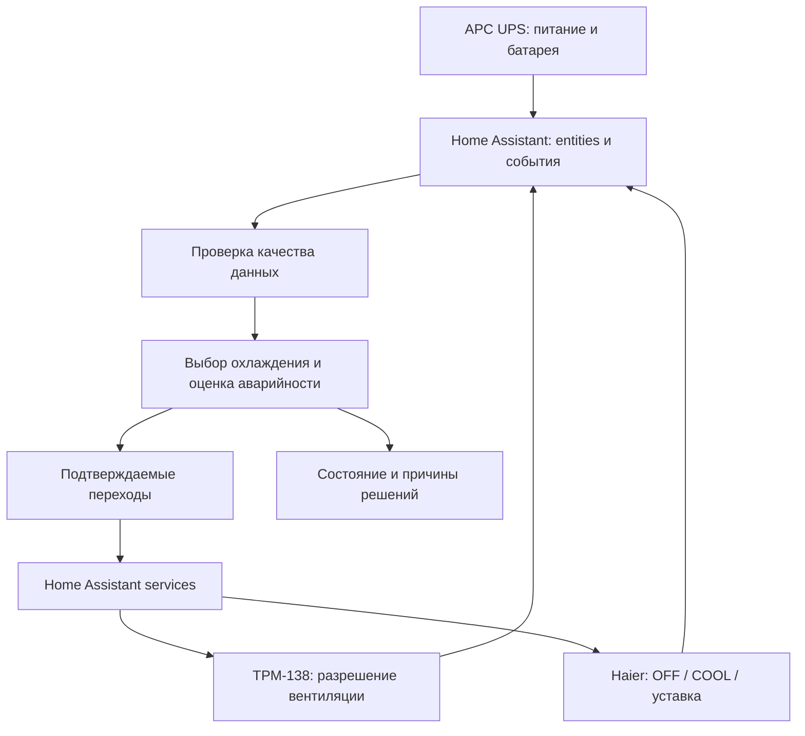

# Server Room Climate Controller

Server Room Climate Controller (SRCC) — проект пользовательской интеграции Home Assistant для координации охлаждения и вентиляции серверного помещения.

Интеграция анализирует внутреннюю и наружную температуру, состояние кондиционера, вентиляции, электросети и UPS, после чего выбирает доступный способ охлаждения. Она использует готовые Home Assistant entities и services: физические устройства и способы их подключения можно заменять без переписывания климатического алгоритма.

Проект относится к бренду **4VRS** и разрабатывается отдельно от Modbus Devices. Domain интеграции: `fourvrs_server_room`.

> **Статус: проектирование.** Репозиторий содержит архитектуру и план проверки. Исполняемая интеграция ещё не реализована; установка через HACS и автоматическое управление оборудованием пока недоступны. Предварительные параметры не являются утверждёнными эксплуатационными настройками.

## Как это работает

Штатный переход с вентиляции на AC выполняется при Tout ≥ +1 °C, обратный переход — при Tout ≤ −1 °C. Между порогами сохраняется текущий пригодный режим. Вентиляция использует C.dr=1 при подтверждённом AC OFF; кондиционирование требует C.dr=0 и снятого выхода вентилятора. ТРМ-138 самостоятельно регулирует вентилятор по температуре помещения. Дополнительный порог Tin в SRCC для штатного разрешения вентиляции не требуется. Для защиты от дребезга применяется гистерезис: разные пороги перехода на кондиционер и возврата к вентиляции, с удержанием текущего пригодного режима между ними. Пороги +1/−1 °C согласованы и настраиваются; временные выдержки ещё согласуются. Температура внутри стойки также участвует в оценке достаточности охлаждения; её пороги и условия досрочного резервного перехода ещё не определены. Новый запуск AC при отрицательной Tout допускается только как аварийный резерв выше AC_HARD_MIN. В режиме кондиционирования вентиляция запрещена и используется COOL. При переключении сначала подтверждается отключение предыдущей системы, затем разрешается запуск следующей.

Предусмотрены способы охлаждения `IDLE`, `VENTILATION`, `AIR_CONDITIONING`, `EMERGENCY_VENTILATION`, `NO_COOLING_AVAILABLE`. Уровень аварийности `NORMAL`, `WARNING`, `CRITICAL` оценивается отдельно от выбранного способа охлаждения.

## Оборудование исходной установки

| Оборудование | Роль |
|---|---|
| ТРМ-138 | Tin/Tout, автономное регулирование вентиляции, C.dr и состояние выхода |
| Haier AS25HSL1HRA-W + 1U25HSL1FRA | Охлаждение через существующую интеграцию Haier-ESP32-Modbus |
| APC Smart-UPS 3000 RM XL с NMC2 | Состояние сети, работа от батареи, заряд и оставшееся время |

SRCC не обращается к Modbus-регистрам, Unit ID, UART или сетевым транспортам устройств. Перечень выше описывает исходную установку, а не жёсткую привязку алгоритма к моделям.

## Только охлаждение

SRCC не управляет обогревом. Для кондиционера используются только OFF, COOL и целевая температура охлаждения; режимы HEAT и автоматического выбора охлаждения/обогрева не запрашиваются. По опыту исходной установки тепловыделения серверной стойки хватает и при наружной температуре около −40 °C: ТРМ-138 реже включает вентиляцию, дополнительное отопление не требуется. Это описание данной установки, а не гарантия для произвольной серверной или нагрузки.

## Регулирование и оценка вентиляции

Tin — температура горячей зоны наверху стойки 42U, измеряемая одним датчиком ТРМ-138. В верхних горячих точках также установлены два независимых температурных датчика системы «Болид». Их показания не предполагаются равными показанию ТРМ.

ТРМ-138 включает вентилятор при 24 °C и выключает при 20 °C; между порогами сохраняет его состояние. При разрешённой вентиляции и подтверждённом активном выходе SRCC оценивает динамику температуры за 5 минут с пятью выборками раз в минуту. Минимально значимый рост ещё согласуется. Падение качества данных или выключение выхода прерывает оценку; редкие включения в мороз не являются неисправностью.

## Температурные границы

| Параметр | Значение для исходной установки | Назначение |
|---|---|---|
| AC_HARD_MIN | −5 °C — подтверждено | Запуск кондиционера запрещён при Tout ≤ −5 °C, включая аварийный резерв |
| NORMAL_VENTILATION_LIMIT | 0 °C — подтверждено | Граница предпочтения штатной вентиляции и кондиционера |
| emergency_delta | Около 5 °C | Минимальная разность Tin−Tout для резервной вентиляции |

AC_HARD_MIN=−5 °C — выбранная эксплуатационная уставка проекта, а не подтверждение паспортной допустимости COOL при этой температуре. Паспортный нижний предел охлаждения для конкретной пары блоков проверяется отдельно. Между −5 и 0 °C вентиляция предпочтительна, а кондиционер может быть резервом при соблюдении всех условий допуска.

Границы остаются параметрами конфигурации; для исходной установки согласованы AC_HARD_MIN=−5 °C и NORMAL_VENTILATION_LIMIT=0 °C. Штатный гистерезис согласован: VENT → AC при +1 °C и выше, AC → VENT при −1 °C и ниже. Выдержки, dwell time, таймауты, emergency_delta, пороги батареи, уровни WARNING/CRITICAL и температурная потребность в аварийном/батарейном режиме ещё согласуются. Ни аварийность, ни отказ вентиляции не обходят AC_HARD_MIN.

## Отказы, UPS и восстановление

- Работа UPS от батареи меняет стратегию энергопотребления, но не включает вентилятор без температурной необходимости.
- Резервная вентиляция допустима только при полезной разности температур и подтверждённом выключении AC. Горячий наружный воздух не используется для охлаждения помещения.
- Недоступность оборудования не считается подтверждением его выключения. Успех вызова HA service не заменяет readback.
- unknown, unavailable и устаревшие данные учитываются отдельно; последнее известное значение не остаётся достоверным бессрочно.
- После перезапуска сначала проверяются текущие состояния оборудования и незавершённые переходы. Команды не воспроизводятся автоматически из сохранённого журнала.
- Отключение автоматики прекращает выдачу новых команд; наблюдение и диагностика продолжаются.

## Границы безопасности

Интеграция дополняет независимый аппаратный аварийный контур. Она не заменяет автономное регулирование ТРМ-138, защиту компрессора, аварийную сигнализацию, защиту нагрузки или EPO. Физическое взаимное исключение при внешнем вмешательстве требует аппаратных средств.

По описанию владельца исходная установка имеет независимую систему пожаротушения на базе аттестованного контроллера «Болид», с отдельным батарейным резервом до 48 часов, питающим только этот контроллер: при температуре ≥30 °C в самой тёплой точке стойки аппаратный контроллер задействует EPO UPS и отключает ввод стойки. Дымовые датчики также инициируют отключение и выпуск Хладона. SRCC не управляет этими действиями. Программные пороги предупреждения и критической температуры ещё согласуются с учётом расположения датчиков; они не заменяют аппаратный порог.

## Документация

- [Архитектура и контракты интеграции](docs/ARCHITECTURE.md).
- [План реализации, критерии приёмки и аппаратные проверки](docs/VALIDATION_PLAN.md).
- [Участие в разработке](CONTRIBUTING.md).
- [История изменений](CHANGELOG.md).

Кондиционер исходной установки питается напрямую от сети и при её пропадании становится unavailable. Вентилятор и ТРМ-138 питаются от UPS. При включённом AC вентиляция ТРМ-138 должна быть заблокирована, а при работающей вентиляции AC должен быть выключен. До реализации необходимо уточнить достаточные сигналы readback, правила IDLE, поведение при потере температур и при пересечении AC_HARD_MIN уже работающим кондиционером. Архитектура описывает эти ограничения явно; аппаратная совместимость пока не подтверждена испытаниями SRCC.
