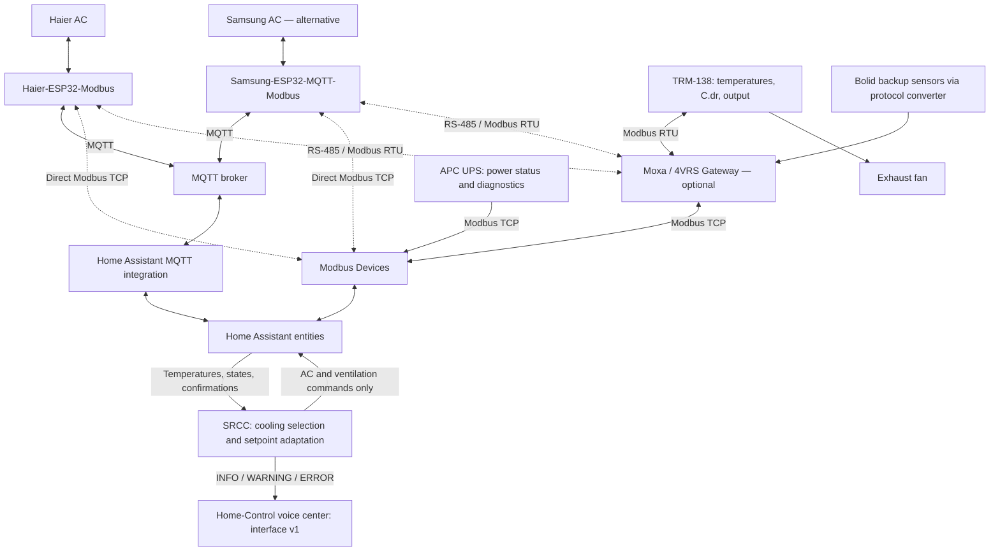

[**English**](README.md) · [**Русский**](README_RU.md)

# Server Room Climate Controller

Home Assistant custom integration for server room cooling: coordinates ventilation and air conditioning, monitors temperature and UPS status, and provides backup sensor support, emergency modes, and verified equipment transitions. A 4VRS project. Integration domain: `fourvrs_server_room`.

## Built for my installation

I develop SRCC primarily for my own server rack and equipment: a TRM-138 temperature controller with an exhaust fan, a Haier AC with an ESP32/Modbus controller, an APC UPS, and Bolid backup temperature sensors. The algorithms and field checks are based on this installation.

I publish the code and documentation as a practical project. Configurable entities allow adaptation, but this is not a ready-made universal controller for every server room. Different equipment requires checks of power wiring, command semantics, state feedback, and temperature thresholds.

## Version 0.8.0

- Seasonal ventilation/AC selection with hysteresis and sequential, confirmed commands.
- Rack overheating takes priority over seasonal cooling choices; UPS power and data quality remain part of every decision.
- Downward-only adaptation: one permanent AC setpoint reduction per WARNING episode, saved into the existing setting after confirmation.
- Temporary cooling assistance when ventilation has chilled the AC inlet sensor; the temporary target is not learned as the permanent setting.
- INFO, WARNING, and ERROR events for the voice center, with input and execution diagnostics.

**201 software tests passed** (95 standalone + 106 HA); hassfest reported **0 invalid integrations**. Sequential Haier commands and seasonal transitions in both directions have been observed on the installation. Version 0.8.0 is installed; permanent adaptation during a real WARNING still needs field confirmation. Software checks do not replace hardware acceptance.

## Install or update

1. Download the integration ZIP from [Releases](https://github.com/dk-1983/SRCC/releases), or use the repository source.
2. Copy `custom_components/fourvrs_server_room` into your HA configuration's `custom_components` directory. Restart Home Assistant.
3. Add **Server Room Climate Controller** through Settings → Devices & services, and follow the [configuration guide](docs/INSTALLATION.md).

A new installation starts with automatic control OFF. Commands require the command profile and **Automatic control**. Its ON/OFF setting survives reload/restart; inputs are checked again before commands. An update does not require deleting the configuration entry.

## Operating rules

These are initial defaults, not universal recommendations. Existing settings are not overwritten during an upgrade.

| Condition | Behavior |
|---|---|
| Outdoor temperature ≥ +1 °C | Normal transition from ventilation to usable AC |
| Outdoor temperature ≤ −1 °C | Normal transition from AC to usable ventilation unless retry is locked |
| Between seasonal thresholds | Keep the current usable cooling method |
| Below the configured AC outdoor minimum | AC start prohibited; initial minimum −15 °C, equality allowed |
| Rack reaches WARNING, initially 26 °C, during confirmed AC operation | One permanent downward setpoint step; rearm below WARNING by 1 °C |
| Rack reaches CRITICAL, initially 28 °C | Prioritize usable AC regardless of seasonal preference |
| Critical recovery | Fresh rack temperature reaches min(critical_recovery, configured AC target + rack offset); no 120-second recovery timer |
| Backup ventilation | Initially ON at 24 °C, OFF at 20 °C; outdoors below +10 °C and colder than the rack |

There is no automatic upward learning. Device setpoint limits and resolution are respected. A thermal incident or sustained warming during ventilation can lock automatic return to ventilation; that lock survives reload. An explicit Automatic control OFF→ON permits a new controlled attempt. See [behavior](docs/BEHAVIOR.md).

In my installation, TRM-138 controls the fan at 24/20 °C with C.dr=1. C.dr=0 allows SRCC to control its output directly. The output is monitored in both modes. AC starts only after automatic ventilation and fan output are confirmed OFF. Ventilation requires confirmed AC OFF or valid evidence that the AC is unpowered. SRCC uses COOL and OFF, not heating. The appliance controls its own compressor protection; SRCC adds no external compressor restart delay.

## Related projects

SRCC works through HA entities. Device drivers and network/serial transports belong to the related projects. MQTT and Modbus are alternative routes; both are not required at once.

Exchange arrows include commands where supported. UPS and backup sensors provide data only; SRCC does not command EPO or fire suppression. Moxa provides the selected serial route; direct TCP or MQTT does not require this gateway.

| Project | Role |
|---|---|
| [Haier-ESP32-Modbus](https://github.com/dk-1983/Haier-ESP32-Modbus) | ESP32 UART bridge with MQTT and Modbus RTU/TCP. My SRCC installation uses MQTT telemetry and command confirmation. |
| [Samsung-ESP32-MQTT-Modbus](https://github.com/dk-1983/Samsung-ESP32-MQTT-Modbus) | Alternative UART/MQTT/Modbus bridge. It works on my Samsung AC; joint operation with SRCC remains a future test. |
| [Modbus Devices](https://github.com/dk-1983/Modbus_Devices) | HA integration providing entities for temperatures, controller outputs, UPS status, and supported climate devices. |
| [Moxa / 4VRS Gateway](https://github.com/dk-1983/moxa-4vrs-gateway) | Network-to-serial gateway on Moxa UC-7420, including Modbus TCP to RTU. |
| [Home-Control](https://github.com/dk-1983/Home-Control) | My apartment automation project, including the voice center that receives SRCC process events through the v1 interface. |

I develop these projects for equipment I have and can test. I do not have other AC brands available and do not claim their compatibility. Additional devices need hardware for testing and open or documented protocols.

Samsung is an alternative, not a second simultaneously controlled AC. Its project currently lacks a software error-free status sensor. The separate fault input is optional in SRCC, but availability does not prove absence of appliance errors. The Haier-specific telemetry profile must not be assumed compatible with Samsung.

## Data and boundaries

A primary rack and an outdoor temperature sensor are required. Zero, one, or two backup sensors can be configured. Valid, time-aligned backups are averaged; one remaining valid backup can be used with a warning. Sensor placement must be checked before treating readings as substitutes.

The fan and TRM in my installation run from UPS. The AC and its communication controller run from the same external supply as the UPS input. Only confirmed wiring and consistent fresh power states allow an unpowered-AC inference; `unavailable` alone does not prove OFF.

The Haier profile uses one UART snapshot, heartbeat checks, and sequential MQTT-result command confirmation. Republishing an old measurement is not confirmation. See [Haier telemetry](docs/HAIER_TELEMETRY.md).

Voice levels and reminders default OFF. They require a receiver implementing the [v1 contract](docs/VOICE_PROTOCOL_V1.md). Notification maintenance does not change cooling. Documentation is bilingual; generated voice messages in this release remain Russian.

Turning automation OFF stops new commands but leaves equipment in its current state. SRCC does not control UPS/EPO or fire suppression, replace independent hardware protection, or provide a hardware interlock between AC and ventilation.

## Documentation

- [Installation](docs/INSTALLATION.md) and [operating behavior](docs/BEHAVIOR.md).
- [Changelog](CHANGELOG.md) and [architecture](docs/ARCHITECTURE.md).
- [Voice notifications](docs/VOICE_NOTIFICATIONS.md) and [receiver contract](docs/VOICE_PROTOCOL_V1.md).
- [Validation and field results](docs/VALIDATION_PLAN.md) and [test catalog](docs/TEST_CATALOG.md).
- [Development](docs/DEVELOPMENT.md) and [contributing](CONTRIBUTING.md).
