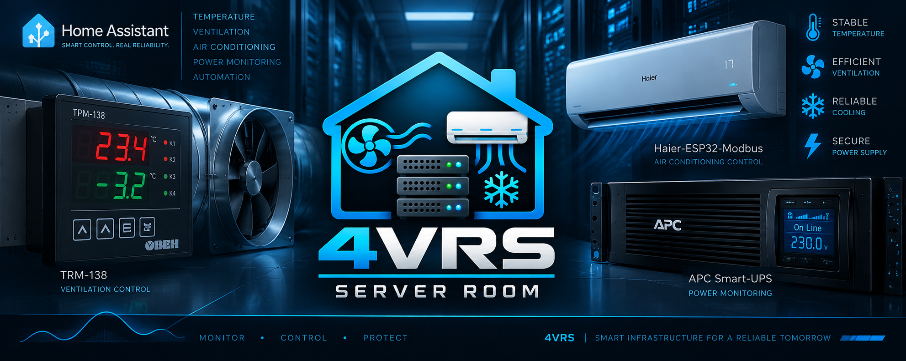

# Server Room Climate Controller

SRCC — пользовательская интеграция Home Assistant для межсезонного переключения вентиляции и кондиционирования серверной. Она читает существующие сущности HA, выбирает доступное охлаждение и последовательно управляет оборудованием с проверкой обратной связи.

Бренд **4VRS**, domain `fourvrs_server_room`. Транспортами Modbus/Wi-Fi занимаются исходные интеграции оборудования.

## Текущий статус

**Версия 0.2.4: наблюдение, явно включаемое управление и журнал испытаний.** При первой установке автоматика выключена. Начиная с 0.2.2 выбранное состояние сохраняется при restart/reload; перед командами заново проверяются входы. Для команд нужны настроенный исполнительный профиль и переключатель Automatic control.

На локальном HA 2026.9.2 и в автономных тестах пройдены **104 теста**, hassfest не обнаружил ошибок. На объекте подтверждены установка, чтение входов, состояние ВУ при автоматическом управлении ТРМ и отображение режима кондиционирования. Полные межсезонные переходы, задержки оборудования и восстановление питания ещё требуют испытаний. Это управляемый пилот; программные тесты не заменяют аппаратную приёмку.

## Поведение

| Условие | Действие |
|---|---|
| Вентиляция, наружная температура ≥+1 °C | Переход на пригодный кондиционер после выдержек и подтверждений |
| Кондиционирование, наружная температура ≤−1 °C | Переход на пригодную вентиляцию |
| Между −1 и +1 °C | Удержание текущего пригодного режима |
| Наружная температура ≤−5 °C | Запуск AC запрещён, включая резерв |
| Резервная вентиляция | Запрос при Tin≥24 °C, снятие при Tin≤20 °C; требуется Tout<+10 °C и Tout<Tin |
| Температура помещения ≥26 / ≥28 °C | WARNING / CRITICAL |
| Восстановление после CRITICAL | ≤27 °C не менее 120 секунд с подтверждённым снижением |

**+10 °C относится только к резервной вентиляции.** Снижение наружной температуры с +13 до +8 °C само по себе не переключает исправный кондиционер на вентиляцию.

В исходной установке ТРМ-138 самостоятельно регулирует вентилятор по 24/20 °C при C.dr=1. При C.dr=0 SRCC может управлять выходом ВУ напрямую. Состояние ВУ читается в обоих режимах. Перед запуском кондиционера подтверждаются C.dr=0 и ВУ=OFF; перед разрешением вентиляции — OFF кондиционера либо допустимое доказательство его обесточивания. AC получает COOL и уставку 22 °C; обогрев не используется.

Температурные входы не привязаны к производителю. Основной и наружный датчики обязательны; резервных может быть 0, 1 или 2. При отказе основного используются пригодные резервы: среднее двух согласованных по времени либо один доступный. Дополнительный датчик fault кондиционера необязателен.

## Питание и ограничения

В исходной установке ТРМ и вентилятор питаются от UPS, а кондиционер и его контроллер связи — от общей с входом UPS внешней линии. Только при подтверждённой схеме и свежих Online=off, On battery=on, climate=unavailable допускается вывод об обесточивании AC. Одна недоступность кондиционера такого вывода не даёт.

Сервис HA и подтверждение оборудованием — разные этапы. Возраст публикации HA не доказывает физический опрос. На объекте наблюдались устаревшие публикации Haier при превышении 120 секунд; интервалы публикаций и задержки подтверждений ещё измеряются.

Выключение автоматики прекращает новые команды, но сохраняет состояние оборудования. После restart/reload ранее включённое управление возобновляется после проверок входов; ручное OFF сохраняется. Ошибки команд фиксируются без автоматических повторов. Тренд вентиляции оценивается по пяти минутным выборкам; без настроенного порога значимого роста автоматическая оценка её неэффективности отключена.

SRCC не управляет UPS/EPO или пожаротушением и не заменяет независимую аппаратную защиту. Авторестарт кондиционера после возврата сети может временно пересечься с работающей вентиляцией; аппаратное взаимное исключение этой интеграцией не обеспечивается.

## Документация

- [Установка и настройки](docs/INSTALLATION.md).
- [Подробное реализованное поведение и параметры](docs/BEHAVIOR.md).
- [Архитектура и границы модулей](docs/ARCHITECTURE.md).
- [Пройденные проверки, полевые наблюдения и план испытаний](docs/VALIDATION_PLAN.md).
- [Каталог автоматических тестов](docs/TEST_CATALOG.md).
- [Среда разработки и команды проверок](docs/DEVELOPMENT.md).
- [Участие в разработке](CONTRIBUTING.md) и [история изменений](CHANGELOG.md).

В публичную документацию входят обезличенные результаты испытаний. Исходные журналы объекта, личные заметки и скриншоты в репозитории не публикуются.

## Допуск кондиционера в 0.2.3

`ac_max_age` / «Максимальный возраст публикации кондиционера» — отдельный предел, по умолчанию **180 s**, включая обновление существующей конфигурации без этого поля. Он применяется к режиму и уставке climate; общий max_age температур, UPS, вентиляции и отдельного fault не меняется. Публикация возрастом ровно 180 s ещё свежая, старше — stale. unavailable/unknown обрабатываются сразу. Время публикации не подменяется; старое состояние не подтверждает новую команду. Тайм-аут команд/readback остаётся прежним (30 s по умолчанию). На рабочий HA изменение вступит после обновления файлов и перезапуска.
