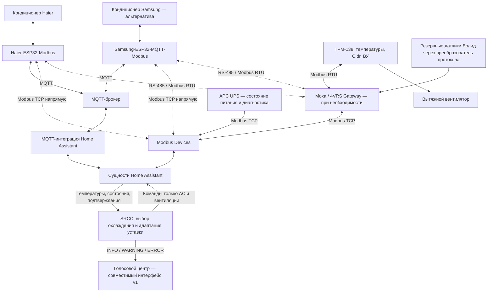

# Server Room Climate Controller

Home Assistant custom integration for server room cooling: coordinates ventilation and air conditioning, monitors temperature and UPS status, and provides backup sensor support, emergency modes, and verified equipment transitions. A 4VRS project.

SRCC управляет охлаждением серверной по температуре стойки и наружного воздуха. Интеграция читает существующие сущности Home Assistant; транспортами Modbus и MQTT занимаются исходные интеграции оборудования. Domain: `fourvrs_server_room`.

## Для какой установки создан проект

Я разрабатываю SRCC прежде всего для своей серверной стойки и своего оборудования: ТРМ-138 с вытяжным вентилятором, кондиционера Haier с контроллером ESP32/Modbus, UPS APC и резервных температурных датчиков «Болид». Алгоритмы и полевые проверки ориентированы на эту установку.

Публикую код и документацию как практический проект. Настраиваемые сущности позволяют адаптацию, но это не универсальное готовое решение для любой серверной. Для другого оборудования необходимо отдельно проверить питание, смысл состояний, команды, обратную связь и температурные пороги. Совместимость с произвольной конфигурацией не заявляется.

## Текущая версия — 0.8.0

- Межсезонное переключение вентиляции и кондиционера с гистерезисом и подтверждением состояний.
- Приоритет охлаждения стойки при перегреве, резервные датчики и учёт питания UPS.
- Постоянная адаптация уставки AC только вниз: один шаг за эпизод WARNING, сохранение в существующее поле после подтверждения команды.
- Временная более низкая уставка при холодном датчике кондиционера после вентиляции. Она не сохраняется как постоянная.
- INFO, WARNING и ERROR для голосового центра, диагностика входов и исполнения команд.

Пройдены **201 программный тест** (95 автономных + 106 HA), hassfest: **0 invalid**. На рабочей установке подтверждены последовательные команды Haier и переключения охлаждения в обоих направлениях. Версия 0.8.0 установлена; постоянная адаптация при реальном WARNING ещё ожидает полевого подтверждения. Программные проверки не заменяют испытания на оборудовании.

## Установка

1. Скопируйте `custom_components/fourvrs_server_room` в каталог `custom_components` конфигурации HA.
2. Перезапустите Home Assistant и добавьте **Server Room Climate Controller** через интерфейс интеграций.
3. Выберите входные сущности и параметры своей установки по [инструкции](docs/INSTALLATION.md).

При первой установке автоматика выключена. Для отправки команд нужны исполнительный профиль и **Automatic control**. Выбранное ON/OFF сохраняется при reload и перезапуске; перед управлением входы проверяются заново. При обновлении файлов также требуется перезапуск HA, пересоздавать запись не нужно.

## Основные правила

Пороги настраиваются; значения ниже описывают начальные настройки, а не универсальные параметры для любой серверной. Сохранённые значения при обновлении не заменяются.

| Условие | Поведение |
|---|---|
| Наружная температура ≥ +1 °C | Штатный переход с вентиляции на пригодный AC |
| Наружная температура ≤ −1 °C | Штатный переход с AC на пригодную вентиляцию, если нет блокировки возврата |
| Между сезонными порогами | Удержание текущего пригодного режима |
| Ниже настроенного минимума AC | Запуск AC запрещён; начальный минимум −15 °C, на границе запуск разрешён |
| Стойка ≥ WARNING (начально 26 °C), работает AC | Постоянный шаг уставки вниз; новый эпизод разрешён после охлаждения до WARNING − 1 °C |
| Стойка ≥ CRITICAL (начально 28 °C) | Приоритет доступного кондиционирования независимо от сезонного выбора |
| Восстановление после CRITICAL | По свежему датчику стойки: min(critical_recovery, уставка AC + поправка стойки); таймера 120 секунд нет |
| Резервная вентиляция | Начально включение при 24 °C, выключение при 20 °C; наружный воздух ниже +10 °C и холоднее стойки |

Автоматического повышения постоянной уставки нет. Нижний предел и шаг берутся из сущности климатического устройства. При перегреве или подтверждённом росте температуры на вентиляции может блокироваться повторный автоматический возврат к ней. Эта блокировка сохраняется при reload; новая контролируемая попытка разрешается явным OFF→ON автоматики. Подробности — в [описании поведения](docs/BEHAVIOR.md).

В исходной установке ТРМ-138 регулирует вентилятор по 24/20 °C при C.dr=1. При C.dr=0 SRCC управляет выходом ВУ напрямую; состояние ВУ наблюдается в обоих режимах. Перед запуском AC подтверждаются C.dr=0 и ВУ=OFF, перед разрешением вентиляции — OFF кондиционера или допустимое доказательство его обесточивания. Используются COOL и OFF; обогрев не применяется. Дополнительной паузы защиты компрессора в SRCC нет — компрессором управляет штатный контроллер кондиционера.

## Данные, питание и ограничения

Основной и наружный датчики обязательны, резервных может быть 0, 1 или 2. При отказе основного используются пригодные резервы: среднее двух согласованных по времени либо один доступный с предупреждением. Датчики разных мест не считаются взаимозаменяемыми без проверки их размещения.

В исходной схеме вентилятор и ТРМ питаются от UPS, а кондиционер и его контроллер связи — от общей с входом UPS внешней линии. Только подтверждённая схема и согласованные свежие сигналы позволяют сделать вывод об обесточивании AC. Одна недоступность сущности этого не доказывает.

Для Haier ESP поддерживается единый UART-снимок, контроль heartbeat и подтверждение последовательных команд через MQTT result. Повторная публикация старого измерения не подтверждает новую команду. [Настройка профиля](docs/HAIER_TELEMETRY.md).

Голосовые уровни и повторы по умолчанию выключены. Для оповещений нужен совместимый приёмник [контракта v1](docs/VOICE_PROTOCOL_V1.md). Обслуживание оповещений не меняет охлаждение.

Выключение автоматики прекращает новые команды, но сохраняет состояние оборудования. SRCC не управляет UPS/EPO или пожаротушением и не заменяет независимую аппаратную защиту. Аппаратное взаимное исключение вентиляции и кондиционера интеграцией не обеспечивается.

## Карта смежных проектов

SRCC работает с сущностями Home Assistant. Чтение оборудования, транспорт и преобразование протоколов выполняют отдельные проекты. На схеме показаны возможные пути подключения: MQTT и Modbus — альтернативы, их не требуется включать одновременно.

Стрелки обмена показывают команды и обратную связь там, где оборудование допускает управление. UPS и резервные датчики используются как источники данных; SRCC не отправляет команды EPO или пожаротушению. Moxa нужен для выбранного последовательного пути, а при прямом Modbus TCP или MQTT отдельный шлюз не требуется.

| Проект | Роль в системе |
|---|---|
| [Haier-ESP32-Modbus](https://github.com/dk-1983/Haier-ESP32-Modbus) | ESP32-мост к UART кондиционера Haier: MQTT и Modbus RTU/TCP. В текущей установке SRCC применяется MQTT с телеметрией и подтверждением команд. |
| [Samsung-ESP32-MQTT-Modbus](https://github.com/dk-1983/Samsung-ESP32-MQTT-Modbus) | Альтернативный ESP32-мост для кондиционера Samsung: UART, MQTT и Modbus RTU/TCP. Предусмотрен как вариант вместо Haier при адаптации установки. |
| [Modbus Devices](https://github.com/dk-1983/Modbus_Devices) | Интеграция HA для чтения и управления Modbus-оборудованием; предоставляет сущности температур, выходов контроллера, состояния UPS и поддерживаемых климатических устройств. |
| [Moxa / 4VRS Gateway](https://github.com/dk-1983/moxa-4vrs-gateway) | Шлюз на Moxa UC-7420 между сетью и последовательными портами; связывает Modbus TCP с Modbus RTU для выбранного пути подключения. |

Я развиваю эти проекты под оборудование, которое есть у меня и которое могу проверить. Других марок кондиционеров в наличии нет, поэтому их совместимость не заявляю. Расширение списка возможно при наличии оборудования для испытаний и открытых либо документированных протоколов.

Samsung показан как альтернатива, а не как второй одновременно управляемый кондиционер. Его совместная работа с SRCC требует отдельной проверки сущности climate, обратной связи и подтверждения команд. Специальный профиль телеметрии Haier нельзя автоматически считать совместимым с Samsung.

## Документация

- [Установка и настройки](docs/INSTALLATION.md), [реализованное поведение](docs/BEHAVIOR.md).
- [История изменений](CHANGELOG.md), [архитектура](docs/ARCHITECTURE.md).
- [Оповещения](docs/VOICE_NOTIFICATIONS.md), [контракт голосового центра](docs/VOICE_PROTOCOL_V1.md).
- [Проверки и полевые результаты](docs/VALIDATION_PLAN.md), [каталог тестов](docs/TEST_CATALOG.md).
- [Разработка](docs/DEVELOPMENT.md), [участие в проекте](CONTRIBUTING.md).
