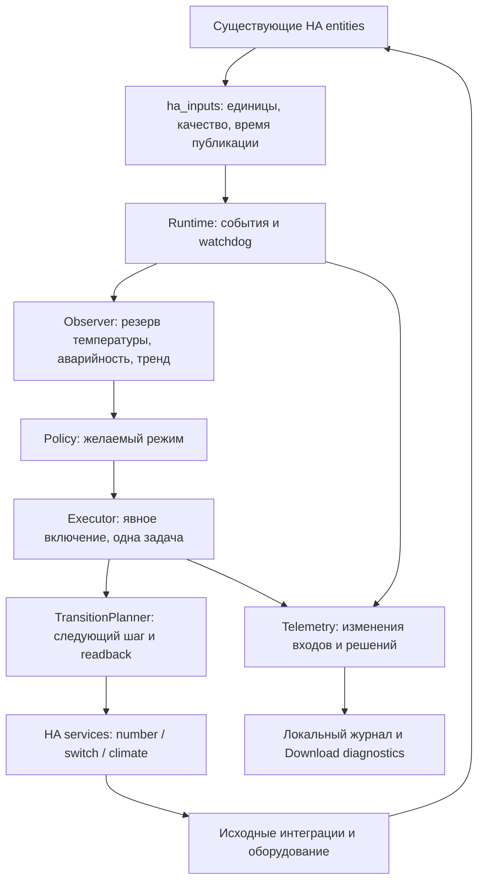

# Архитектура SRCC 0.2.3

Дополнение 0.4.0: [клиент голосового центра и таблица событий](VOICE_NOTIFICATIONS.md), [публичный контракт v1](VOICE_PROTOCOL_V1.md). Приёмник Home Control ещё не реализован. Настройки оповещений не меняют алгоритм охлаждения.

Дополнение 0.3.0: [профиль Haier ESP v1.3.0](HAIER_TELEMETRY.md) описывает новые настройки, подтверждение команд и границы свежести. При его выборе правила этого профиля имеют приоритет над описанием чтения обычного climate ниже.

Актуальная реализация на 2026-09-22, код `0cb8100`. Подробные правила — [BEHAVIOR.md](BEHAVIOR.md); установка — [INSTALLATION.md](INSTALLATION.md); доказательства — [VALIDATION_PLAN.md](VALIDATION_PLAN.md).

## Поток данных и команд

Ядро в `core/` не импортирует Home Assistant, не вызывает сервисы и получает явное время. Runtime подписывается на назначенные entities, раз в секунду проверяет свежесть, выбирает резервы раз в минуту. Единственный путь выдачи команд — Executor. Транспортами управляют исходные интеграции.

## Границы моделей

`Sample` хранит нормализованное значение, источник, время и качество. `Snapshot` — входы оборудования, питание и доказательства. `Decision` — желаемый режим/причина/срочность; оно не доказывает действие. `Step` — этап исполнения, возможное намерение команды, причина или завершение.

Режим по входам HA, предложенный режим и температурная аварийность вычисляются отдельно. Отсутствие readback не превращается в OFF. Дополнительное доказательство обесточивания AC допустимо только по явно подтверждённой схеме общего ввода и свежим сигналам UPS.

## Исполнение и жизненный цикл

Executor выполняет одну задачу без eager-start, последовательно ждёт HA services и каждый раз обновляет входы. Планировщик ожидает новые публикации после отправки. Смена цели/питания пересоздаёт план на текущих данных; идентификатора физической команды в протоколе приборов нет. Устойчивость к поздним событиям и многократной смене цели требует расширенных тестов N04.

После создания runtime управление выключено до чтения сохранённого выбора. После загрузки платформ сохранённое ON запускает новое согласование, если исполнительный профиль включён. Исполнительный профиль не равен разрешению текущего запуска: требуется switch Automatic control. Disable меняет поколение; следующая команда старой задачи не отправляется. Уже вызванный сервис может завершиться. Unload отключает runtime, снимает подписки и дожидается активной задачи. Ошибка/тайм-аут фиксируются без автоматического retry; новое включение сбрасывает исполнительную ошибку и начинает новую сверку.

Есть таймер непрерывности кандидата и dwell от подтверждённой смены режима. С версии 0.6.0 дополнительная пауза запуска AC удалена; его локальной защитой управляет штатный контроллер. Срочный запрос, поддержание достигнутого режима и восстановление охлаждения из подтверждённого IDLE обходят сезонные выдержки; неизвестный/конфликтующий режим и батарея разрешают немедленное согласование, но не обходят readback/hard-min. Подробную матрицу комбинаций требуется проверить полным HA-сценарием. Никакие таймеры не заявляются аппаратной защитой компрессора.

## Владение вентиляцией

Профиль 0/1: разрешение `number` либо `switch`; прямой выход — отдельный `switch`. После readback 0 разрешены FAN_ON/FAN_OFF. В штатном режиме readback 1 означает автономное регулирование внешнего контроллера; SRCC наблюдает выход. Для исходного ТРМ138 это C.dr и ВУ 1. Произвольный ненулевой номер C.dr не нормализуется автоматически в True.

Перед COOL обязательны снятая привязка и ВУ OFF. Перед штатной вентиляцией — AC OFF. Перед резервной — OFF либо доказанное обесточивание. Владельцем допускается переходное пересечение при авторестарте после возврата питания. Строгого физического interlock средствами HA не обещается.

## Хранение и диагностические данные

В ConfigEntry/options хранятся роли и параметры; options заменяют конфигурацию полностью, позволяя очищать необязательные поля. Существующие ключи температур сохраняются для совместимости. Поддерживается одна запись SRCC.

В памяти runtime: окна тренда/восстановления, температурная CRITICAL, запрос резервного охлаждения, признак неэффективной вентиляции, исполнительный план, последние 100 событий. Перезапуск сбрасывает эти данные. Выбор оператора ON/OFF хранится отдельно в HA Store; остановка runtime его не перезаписывает. Подтверждённые физические состояния после загрузки получаются заново из HA, а не восстанавливаются из журнала.

Экспорт диагностики содержит роли, качество/возраст, решения, события и параметры без исходных entity IDs/сырых attributes. В entity источника температуры конкретный ID может отображаться локально оператору. INFO-события команд отличаются от readback; WARN обозначает ухудшение качества или ошибку. История не является постоянным аудитом.

## Ограничения профиля

Сигнал `last_reported` — время HA-публикации, не универсальный heartbeat прибора. max_age применяется к источникам кроме climate; ac_max_age отдельно задаёт свежесть состояния и уставки AC; наблюдённые пропуски публикаций Haier требуют проверки N01. Температуры универсальны по производителю; исполнительные интерфейсы пока ограничены профилем 0/1 и climate OFF/COOL.

Не реализованы постоянная аварийная фиксация, автоматическое включение управления после рестарта, батарейный бюджет по заряду/runtime, самостоятельное доказательство вращения вентилятора или неисправности компрессора. Пожарный контроллер, его резервное питание и аппаратное отключение независимы от SRCC; команды им не отправляются.

## Допуск кондиционера в 0.2.3

`ac_max_age` / «Максимальный возраст публикации кондиционера» — отдельный предел, по умолчанию **180 s**, включая обновление существующей конфигурации без этого поля. Он применяется к режиму и уставке climate; общий max_age температур, UPS, вентиляции и отдельного fault не меняется. Публикация возрастом ровно 180 s ещё свежая, старше — stale. unavailable/unknown обрабатываются сразу. Время публикации не подменяется; старое состояние не подтверждает новую команду. Тайм-аут команд/readback остаётся прежним (30 s по умолчанию). На рабочий HA изменение вступит после обновления файлов и перезапуска.

## Уточнение 0.7.0

Восстановление CRITICAL теперь определяется двумя свежими измерениями после перегрева: текущая температура кондиционера ≤ целевой уставки SRCC и температура стойки ≤ critical_recovery. Длительность recovery_hold удалена. Отрицательные сезонные пороги разрешены; ac_hard_min является включительной нижней границей запуска, новое начальное значение −15 °C. Сохранённые настройки не заменяются. Описание прежних временных окон выше относится к предыдущим версиям.
