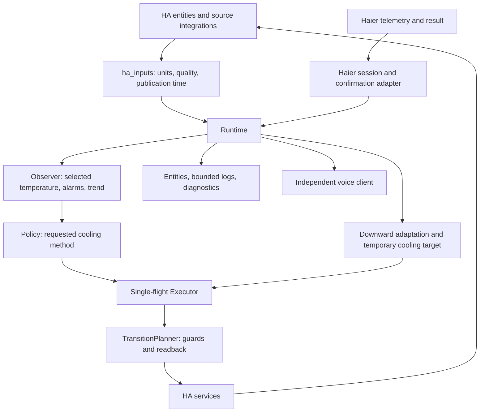

[**English**](ARCHITECTURE.md) · [**Русский**](ARCHITECTURE_RU.md)

# SRCC architecture — 0.8.0

SRCC coordinates existing HA entities. It does not implement Modbus, MQTT device discovery, UART polling, UPS control, or fire suppression. See [behavior](BEHAVIOR.md), [installation](INSTALLATION.md), and [validation](VALIDATION_PLAN.md).

## State separation

The requested cooling method, reported equipment state, alarm severity, data quality, and execution phase are separate values. A successful service call is not a confirmed physical result. Unavailable equipment is not automatically OFF.

`Sample` carries a value, source, timestamp, quality, and optional freshness limit. `Snapshot` combines temperatures, power evidence, equipment states, and command feedback. Configuration validates threshold ordering and nonnegative timing/offset values.

The Observer chooses the primary temperature or valid backups, evaluates alarms before trend analysis, and calls the pure cooling policy. The planner checks every transition and waits for readback. The Executor serializes service calls and never discards an unresolved command just because the requested mode changes.

## Modules

| Module | Responsibility |
|---|---|
| `core/models.py` | Samples, snapshots, configuration, modes, quality |
| `core/inputs.py` | Primary/backup selection and timestamp skew |
| `core/severity.py` | Rack WARNING/CRITICAL and temperature-based recovery |
| `core/health.py` | Five-sample ventilation trend |
| `core/policy.py` | Requested cooling method and blockers |
| `core/timing.py` | Seasonal stability and dwell timing |
| `core/transitions.py` | Ordered actions, interlocks, readback deadlines |
| `ha_inputs.py`, `haier_telemetry.py` | HA input normalization and Haier-specific evidence |
| `runtime.py`, `execution.py` | Event/timer orchestration and serialized commands |
| `adaptation.py` | One permanent downward setpoint step per warning episode |
| `telemetry.py`, `diagnostics.py` | Bounded events and sanitized diagnostics |
| `voice.py`, `voice_events.py`, `voice_details.py` | Independent notification transport and semantic events |
| `configuration.py`, `config_flow.py` | Shared validation and configuration UI |

## Persistence and restart

Automatic control ON/OFF, notification maintenance, ventilation retry lock, and the processed adaptation episode are stored in HA Store. A confirmed permanent AC target is written into the existing `ac_target` configuration option. This internal update does not reload the integration. A manual options change still reloads when configuration differs.

Trend windows, the thermal CRITICAL latch, temporary AC target, pending adaptation proposal, executor plan, and recent-event buffer are in memory. Restart reconstructs decisions from current data; it does not replay commands. An adaptation episode is marked processed before sending its command, preventing another decrement after restart during the same overheating episode. If confirmation/persistence was interrupted, the previous permanent setting remains until a new eligible episode.

On unload, new commands stop and active tasks are cleaned up. The stored control preference is not overwritten by shutdown. Missing or untrusted restored inputs cannot authorize equipment actions.

## Boundaries

Diagnostics expose roles, quality/age, decisions, settings, and bounded event history rather than raw source attributes or source identifiers. The selected temperature entity ID may be visible locally in HA. Diagnostic history is not a permanent audit trail.

Notifications cannot block cooling: their service calls run separately with bounded timeouts. Device firmware controls compressor protection. The hardware fire controller remains independent. The public voice interface is specified in [VOICE_PROTOCOL_V1.md](VOICE_PROTOCOL_V1.md).
