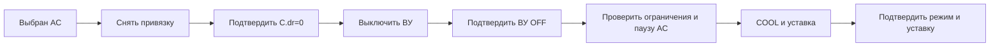

# Реализованное поведение SRCC 0.3.0

Дополнение 0.3.0: [профиль Haier ESP v1.3.0](HAIER_TELEMETRY.md) описывает новые настройки, подтверждение команд и границы свежести. При его выборе правила этого профиля имеют приоритет над описанием чтения обычного climate ниже.

Дата сверки: 2026-09-22, базовый код `0cb8100`, восстановление управления добавлено в 0.2.2. Документ описывает текущую реализацию и согласованный профиль исходной установки. Он не означает, что каждый сценарий испытан на физическом оборудовании. Доказательства и незавершённые проверки приведены в [VALIDATION_PLAN.md](VALIDATION_PLAN.md).

## Назначение и режим включения

Основная задача — межсезонный выбор между автономной вентиляцией и охлаждением кондиционером. Резервные и аварийные алгоритмы дополняют этот выбор. SRCC получает данные из существующих сущностей Home Assistant; транспортами Modbus/Wi-Fi занимаются исходные интеграции.

При первой установке SRCC наблюдает. Для управления нужны исполнительный профиль и Automatic control. Начиная с 0.2.2 выбор ON/OFF сохраняется при restart/reload, включая изменение options. Восстановленное ON создаёт новый план по текущим входам; команды из предыдущего запуска не воспроизводятся. Отключение исполнительного профиля сбрасывает сохранённое ON. Ошибка чтения хранилища не разрешает команды.

Выключение Automatic control запрещает последующие команды, но не выключает оборудование и не отменяет уже переданную команду. Например, если C.dr=0 и ВУ=ON, после выключения автоматики вентилятор остаётся в последнем состоянии, а ТРМ не возвращается к терморегулированию автоматически.

## Входы и состав оборудования

| Роль | Что используется | Обязательность |
|---|---|---|
| Основная температура | Температура помещения/стойки; приоритетный источник | Всегда |
| Наружная температура | Выбор охлаждения и ограничения | Всегда |
| Резерв 1 / резерв 2 | Независимые температурные sensor | Можно 0, 1 либо 2 |
| Разрешение вентиляции | В исходном профиле C.dr=0/1 | Для управления |
| Выход вентилятора | switch с реальным чтением ВУ | Для управления |
| Кондиционер | climate с OFF/COOL и температурной уставкой | Для управления |
| Fault кондиционера | Дополнительный binary_sensor ошибки | Необязателен |
| UPS Online / On battery | Состояние внешнего питания и работы от батареи | Для управления |

Температуры принимаются в °C, °F и K, в ядре — °C. Названия производителей не ограничивают температурные входы. Внутренние ключи trm/bolid и существующие коды источников оставлены для совместимости. Исполнительный профиль пока поддерживает именно разрешение 0/1: number либо switch, и отдельный switch выхода. Произвольные регистры, select, другие значения привязки и составы приводов автоматически не распознаются.

## ТРМ-138 и ВУ

В исходной установке C.dr=1 возвращает регулирование ТРМ, C.dr=0 снимает привязку и позволяет прямое управление выходом. Ноль C.dr сам по себе не доказывает выключение вентилятора. Для переключения нужны два отдельных readback: привязка снята и ВУ=OFF.

| Состояние привязки | Кто переключает вентилятор | Действия SRCC с ВУ |
|---|---|---|
| C.dr=1 | ТРМ по своим температурным уставкам | Чтение ON/OFF; сбор тренда при включённом выходе |
| C.dr=0 подтверждён | SRCC, если включена его автоматика | Команды ON/OFF и чтение результата |
| C.dr неизвестен/устарел | Право ручного управления не доказано | Прямое переключение не допускается |

Выход ВУ подтверждает электрическое управляющее состояние, а не механическое вращение/расход воздуха. По руководству ТРМ138, таблица Б.2, страница 71, состояния ВУ 1–8 читаются по адресам 0–7 в группе функций 01/05; SRCC сам Modbus-запросы не формирует.

## Штатное межсезонное переключение

Таблица применима при наличии сети, пригодных входах и доступности требуемого оборудования. Смена кандидата ещё не означает отправку команды: дополнительно проверяются выдержки и readback.

| Текущее подтверждённое охлаждение | Наружная температура | Выбор |
|---|---|---|
| Вентиляция | Ниже +1 °C | Сохранять вентиляцию |
| Вентиляция | +1 °C и выше | Кондиционер |
| Кондиционер | Выше −1 °C | Сохранять кондиционер |
| Кондиционер | −1 °C и ниже | Вентиляция, если она пригодна |
| Неизвестно; обе системы пригодны | Между −1 и +1 °C | Начальный выбор вентиляции |

Удержание относится к пригодному режиму. Если оборудование/данные непригодны, рассматривается другой маршрут или блокировка. В режиме вентиляции C.dr=1 не означает постоянную работу вентилятора: ТРМ включает его при 24 °C и выключает при 20 °C. SRCC не повторяет этот термостат в штатной ветке.

**+10 °C — не порог штатного переключения.** Например, при снижении с +13 до +8 °C исправный AC остаётся выбранным. Порог +10 используется только для резервной вентиляции.

## Командные последовательности

Для штатной вентиляции: OFF AC → новое подтверждение OFF → разрешение терморегулятора → подтверждение C.dr=1. Для резервной вентиляции: доказать OFF/обесточивание AC → подтвердить C.dr=0 → ON ВУ → подтверждение. Для остановки резерва выход переводится в OFF; полная последовательность IDLE также требует доказанного OFF/обесточивания AC.

С 0.2.6 COOL отправляется через `climate.set_hvac_mode`; после нового подтверждения COOL целевая температура отправляется отдельным `climate.set_temperature` без `hvac_mode`. Если COOL уже подтверждён, выполняется только коррекция температуры. Для OFF используется `climate.set_hvac_mode`. Допустимость COOL и диапазон уставки сверяются с attributes climate. С версии 0.2.4 коррекция уставки при уже подтверждённом AIR_CONDITIONING выполняется без сезонных hold/dwell; все проверки данных и оборудования остаются. Возврат из AUTO/OFF может требовать выдержки запуска AC; это отдельный случай.

Сервис и подтверждение — разные этапы. Подтверждение должно быть свежим, с публикацией позже отправки намерения. Команды сериализованы. Ошибка сервиса или тайм-аут фиксируются без бесконечных повторов. Повторное включение автоматики начинает согласование по текущим входам.

## Питание и резерв

Для исходной установки владелец подтвердил общий внешний ввод AC и входа UPS. Кондиционер и его контроллер связи не имеют питания от UPS; ТРМ и вентилятор питаются от UPS. Профиль общего ввода включается отдельной настройкой и не переносится на другую установку без проверки схемы.

| Сигналы | Вывод |
|---|---|
| Свежие Online=on, On battery=off | MAINS |
| Свежий On battery=on | BATTERY; этого одного ещё недостаточно для доказательства обесточивания AC |
| Подтверждён общий ввод; свежие Online=off, On battery=on; climate=unavailable | Допускается отдельное доказательство отсутствия питания AC |
| climate=unavailable при наличии сети | AC недоступен; OFF не доказан |
| Нет достоверной комбинации питания | UNKNOWN; обычный запуск блокируется |

При возвращении сети или потере свежести доказательство обесточивания утрачивается. Авторестарт Haier подтверждён руководством (раздел 6, страница 36), но его фактическая задержка на установке ещё не измерена. Краткое пересечение AC/вентиляции при возврате сети владелец допускает. SRCC устраняет расхождение после новых данных; аппаратное взаимное исключение не заявляется. Пока автоматика выключена, расхождение может отражаться как OTHER_CRITICAL; при включённой автоматике краткий конфликт сам по себе не считается температурной аварией.

Резерв работает по гистерезису Tin: ≥24 °C — запрос ON, ≤20 °C — запрос OFF, между порогами удержание запроса. При первом определении запроса внутри полосы учитывается подтверждённое состояние ВУ. CRITICAL также создаёт срочный запрос. Дополнительно обязательны Tout<10 °C и Tout<Tin. Минимальная разность по исходному профилю 0 °C; равные температуры всё равно не допускают запуск. На +10 °C резерв уже запрещён.

Батарея разрешает этот маршрут только при настроенных резервных порогах. При неработающем AC и наличии сети резерв также может рассматриваться, но для включения вентиляции по-прежнему требуется доказанный OFF AC. NO_COOLING_AVAILABLE не равен команде «выключить всё». Недостаток температур, питания или readback может оставить оборудование в последнем состоянии; потеря данных не даёт права выдумать его состояние.

## Температурные источники и аварийность

Основной датчик всегда приоритетен. При его отказе: один назначенный пригодный резерв используется напрямую; два пригодных — усредняются при допустимой разнице времени публикаций; один потерян из двух назначенных — используется второй с предупреждением. Если двух пригодных показаний нельзя согласовать по времени, достоверная резервная температура не формируется. Отсутствие неназначенного датчика не является отказом.

Смена источника сбрасывает окно тренда и выдержку снятия CRITICAL. Температура ≥28 °C проверяется сразу, без ожидания пяти минут. При потере всех температур сохраняющаяся в памяти CRITICAL не снимается; новой числовой температуры не создаётся. При исправном основном датчике потеря резерва видна в журнале качества, но выбранный температурный источник остаётся основным.

| Условие | Результат |
|---|---|
| Tin≥26 °C | WARNING |
| Tin≥28 °C | Температурная CRITICAL |
| После CRITICAL: Tin≤27 °C не менее 120 s, минимум 3 новых измерения и отрицательный тренд | Снятие температурной фиксации |
| Плоская/растущая температура, превышение 27 °C, разрыв данных или смена источника | Выдержка не завершает снятие аварии |
| Tout≤−5 °C | Любой новый запуск AC запрещён, включая срочный резерв |

Срочность может обходить оптимизационные выдержки выбора, но не hard-min, подтверждения оборудования и минимальную выдержку AC. WARNING не имеет отдельного гистерезиса. Фиксация аварии хранится только до restart/reload; после старта оценка начинается с текущих данных.

## Тренд вентиляции

При свежих подтверждённых C.dr=1 и ВУ=ON начинается окно. Пять разных свежих измерений берутся на минутах 1, 2, 3, 4 и 5, затем окно скользит. Повторное чтение одной публикации не становится новым измерением. Выключение, плохие данные и смена источника сбрасывают окно.

Положительный тренд и рост не меньше `minimum_vent_rise` позволяют предположить неэффективность. Без заданного порога показывается тренд, но автоматический отказ по росту не объявляется. В профиле пилота значение пока оставлено пустым. После выявления признак удерживается в памяти runtime; повторное включение автоматики сбрасывает его. Непрерывная оценка компрессора по температуре и отдельный датчик потока в этой версии не реализованы.

## Параметры и происхождение значений

| Параметры | Значения | Статус |
|---|---|---|
| Нормальный гистерезис | +1 / −1 °C | Согласован |
| Уставка AC / hard-min | 22 / −5 °C | Согласованы; hard-min не заменяет паспорт конкретной модели |
| Резерв ON/OFF / наружный предел | 24 / 20 / 10 °C | Согласованы; наружная граница строгая |
| WARNING / CRITICAL / recovery | 26 / 28 / 27 °C, 120 s со снижением | Согласованы |
| publication age / backup skew / sampling tolerance / recovery gap | 120 / 10 / 5 / 70 s | Предварительные настройки пилота, нужны реальные интервалы обновления |
| timeout / condition hold / dwell / AC off wait | 30 / 30 / 300 / 180 s | Настраиваемые стартовые значения реализации, не измеренные задержки приборов |
| minimum_vent_rise | Не задан | Автоматическая оценка неэффективности по росту отключена |

Период проверки runtime — 1 s, резервные выборки — раз в 60 s. Это чтение HA, не физический опрос контроллеров. `last_reported` отражает публикацию исходной интеграции, а не гарантирует измерение на приборе.

## Что видно оператору

11 sensors, 4 binary sensors и switch Automatic control. `Suggested cooling mode` — решение; `Reported cooling mode` — согласованная комбинация входных состояний; это разные понятия. HOLD_AC означает сохранение пригодного режима AC, а не факт новой команды. Controller degraded обозначает неполноту данных/решения либо ошибку/блокировку исполнения, а не обязательно физическую поломку.

В Decision reason: этап исполнения, причина/ошибка, проблемные роли, последняя команда. В Download diagnostics: возраста входов, последние 100 событий UTC, оставшиеся выдержки. История сбрасывается при reload/restart. INFO-журнал включается через Enable debug logging; ухудшение качества и ошибки записываются на WARNING. Логи не являются автономным аудитом с сохранением между загрузками.

Известная особенность 0.2.1: WAIT_TIMING может отображаться после достижения нужного состояния, поскольку таймер проверяется перед повторным подтверждением завершения. Это не доказывает новую команду; нужно смотреть readback и command_sent. В 0.2.4 исправлено для подтверждённого AIR_CONDITIONING; другие режимы по-прежнему требуют отдельной проверки.

## Допуск кондиционера в 0.2.3

`ac_max_age` / «Максимальный возраст публикации кондиционера» — отдельный предел, по умолчанию **180 s**, включая обновление существующей конфигурации без этого поля. Он применяется к режиму и уставке climate; общий max_age температур, UPS, вентиляции и отдельного fault не меняется. Публикация возрастом ровно 180 s ещё свежая, старше — stale. unavailable/unknown обрабатываются сразу. Время публикации не подменяется; старое состояние не подтверждает новую команду. С 0.2.5 подтверждение AC ожидается отдельно до 180 s; сервисный вызов и readback вентиляции — до 30 s по умолчанию. На рабочий HA изменение вступит после обновления файлов и перезапуска.

## Фикс 0.2.5: ожидание команд AC

Новая настройка «Ожидание подтверждения команды кондиционера» (`ac_readback_timeout`) по умолчанию 180 s, применяется и к существующим исполнительным конфигурациям без этого поля. Ожидание начинается с выдачи команды. Для AC OFF, COOL и изменения уставки используется этот предел; вызов сервиса HA и подтверждение вентиляции сохраняют `command_timeout` (30 s по умолчанию). `ac_max_age=180 s` отдельно определяет свежесть опубликованных состояний.

До readback следующая команда не выдаётся. Смена решения/питания не удаляет незавершённое ожидание. При отсутствии подтверждения фиксируется READBACK_TIMEOUT без повторов; поздняя публикация сама ошибку не снимает. После устранения причины оператор выключает и включает Automatic control. Увеличение времени не доказывает физическое исполнение и не исправляет unavailable. Нужен повторный аппаратный тест команды с журналом.
